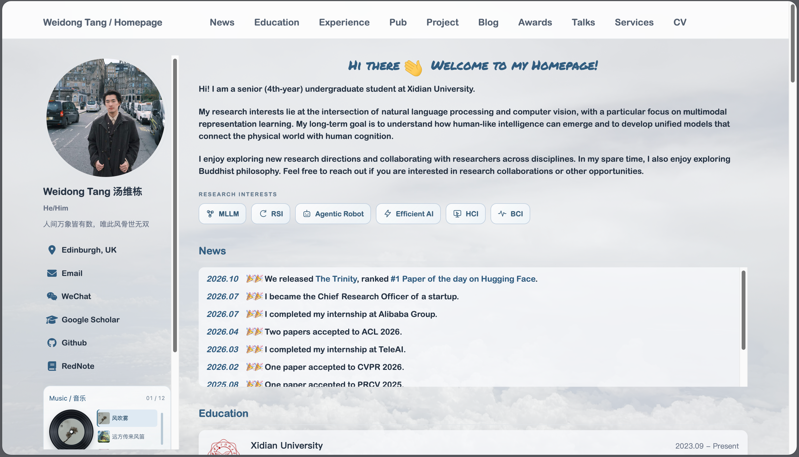
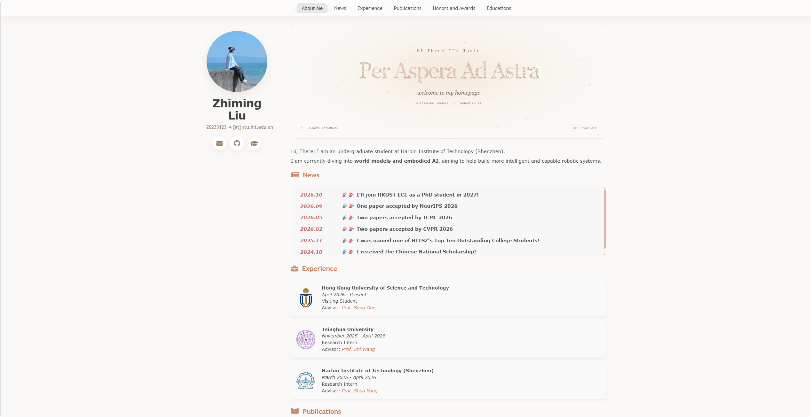

# WowPage

English | [简体中文](README.zh-CN.md)

WowPage is a Jekyll academic homepage template for GitHub Pages. It includes an introduction, news, education, experience, publications, projects, awards, talks, and services. Profile details and research illustrations use placeholders that you can replace with your own.

Publications support featured cards and a full list. Blog contains three empty boxes with no content or links, and the music player is optional. No CV is bundled; add a link to your own CV when ready.

[Live demo](https://wd7ang.github.io/WowPage/) · [Showcase](#showcase) · [Customization guide (中文)](docs/customization.md) · [Changelog](CHANGELOG.md)

## Versions

| Branch | Version | Contents |
| --- | --- | --- |
| [`main`](https://github.com/WD7ang/WowPage/tree/main) / [`v2`](https://github.com/WD7ang/WowPage/tree/v2) | `v2.0.9` | Current template, with content and components maintained separately |
| [`v1`](https://github.com/WD7ang/WowPage/tree/v1) | `v1.0.0` | Classic WowPage layout and interactive examples |

Both versions are standalone Jekyll projects. Choose one branch for your site. This README describes v2.

## Quick start

Install Ruby, Bundler, and Git, then run:

```sh
git clone https://github.com/WD7ang/WowPage.git
cd WowPage
bundle install
bundle exec jekyll serve
```

Open the address printed in the terminal, usually `http://127.0.0.1:4000`. If you set a `baseurl`, append it to that address. Restart the server after changing `_config.yml`.

Normal content edits and Jekyll builds do not require Node.js. Use Node.js 20+ for the validation script or rebuilding the base theme's JavaScript.

## Where to edit

| Content | File |
| --- | --- |
| Name, avatar, email, social accounts, site URL | `_config.yml` |
| Introduction and research interests | `_data/profile.json` |
| Navigation | `_data/navigation.yml` |
| News | `_data/news.json` |
| Education and experience | `_data/education.json`, `_data/experience.json` |
| Publications and projects | `_data/publications.json`, `_data/projects.json` |
| Awards, talks, and services | `_data/awards.json`, `_data/talks.json`, `_data/services.json` |
| Three Blog placeholder boxes | `_includes/home/blog.html` |
| Optional playlist | `_data/music.json` |
| Images and generic illustrations | `images/`, `images/placeholders/` |

In the sidebar configuration, `author.twitter` and `author.github` take usernames, while `author.googlescholar` takes a full profile URL. Replace the default placeholders; leave an optional social field empty to hide it. Avatar paths are relative to `images/`. The sidebar has no Institution row.

Set a publication's `featured` field to `true` to show it as a card; the full list includes every entry. Blog placeholders do not automatically list posts. Edit their structure in `_includes/home/blog.html` and their styles in `assets/css/home-sections.css`. The `/blog/` URL redirects to the homepage's Blog section.

The playlist defaults to `[]`, so the player is hidden and no songs are requested. To add a CV, put your own external CV link in `_data/navigation.yml`. See the [customization guide (中文)](docs/customization.md) for field examples, link formats, and music configuration.

## Deploy to GitHub Pages

1. Create your own repository using **Use this template** or a fork.
2. Replace the placeholder profile and content. By default, `url`, `baseurl`, and `repository` are unset in `_config.yml`, allowing GitHub Pages to infer them. For explicit configuration, use the examples below.
3. Open **Settings → Pages → Deploy from a branch**, then select `main` and `/ (root)`.

| Setting | User site | Project site |
| --- | --- | --- |
| Repository name | `your-username.github.io` | For example, `WowPage` |
| `url` | `https://your-username.github.io` | `https://your-username.github.io` |
| `baseurl` | `""` | `"/WowPage"` |
| `repository` | `your-username/your-username.github.io` | `your-username/WowPage` |

Do not include the repository path or a trailing `/` in `url`. Select the `v1` branch instead if you deploy the classic version.

## Project structure

```text
_config.yml          Site identity and Jekyll settings
_data/               Editable content data
_pages/              Homepage, Blog redirect, 404, and sitemap
_posts/              Optional posts; initially empty
_includes/home/      Homepage section components
_includes/           Shared theme and music components
_layouts/            Page and generic article layouts
assets/css/          Homepage, article, and music styles
assets/js/           Feature scripts
_sass/               Base theme and third-party styles
images/              Images and placeholders
docs/                Customization documentation; excluded from the site
scripts/             Build checks; excluded from the site
```

Change section order in `_pages/about.md`, content in `_data/`, structure in `_includes/home/`, and styling in `assets/css/`. Most customization only needs configuration and data edits. Both README files are excluded from the published site.

## Validation

Build the site and check local links, images, CSS assets, and anchors:

```sh
bundle exec jekyll build
node scripts/check-site.mjs
```

If your build uses a project prefix, pass the same prefix to the checker:

```sh
bundle exec jekyll build --baseurl /WowPage
node scripts/check-site.mjs --baseurl /WowPage
```

Replace `/WowPage` with your own prefix. Generated files go into `_site/` and should not be committed. The checker needs no `npm install`; CI checks both the root path and `/WowPage`.

Only run `npm install` and `npm run build:js` when you edit the base theme's JavaScript and need to regenerate `assets/js/main.min.js`. Other feature scripts do not need bundling.

## Credits and license

Released under the [MIT License](LICENSE). Built on [AcademicPages](https://github.com/academicpages/academicpages.github.io) and [Minimal Mistakes](https://github.com/mmistakes/minimal-mistakes). WowPage originated from [Yue Su / Selen-Suyue's template](https://selen-suyue.github.io/) and was developed by Weidong Tang and Yue Su. These credits identify the template's authors; users supply their own profile details.

The welcome heading uses [Permanent Marker](https://fonts.google.com/specimen/Permanent+Marker) by Font Diner, bundled locally under its [Apache 2.0 license](assets/fonts/permanent-marker/LICENSE.txt). Third-party font and script notices remain with their source files.

## Showcase

| Preview | Link |
| --- | --- |
|  | **Weidong Tang**<br>[https://wd7ang.github.io/](https://wd7ang.github.io/) |
|  | **Zhiming Liu**<br>[https://mikuz12.github.io/](https://mikuz12.github.io/) |
