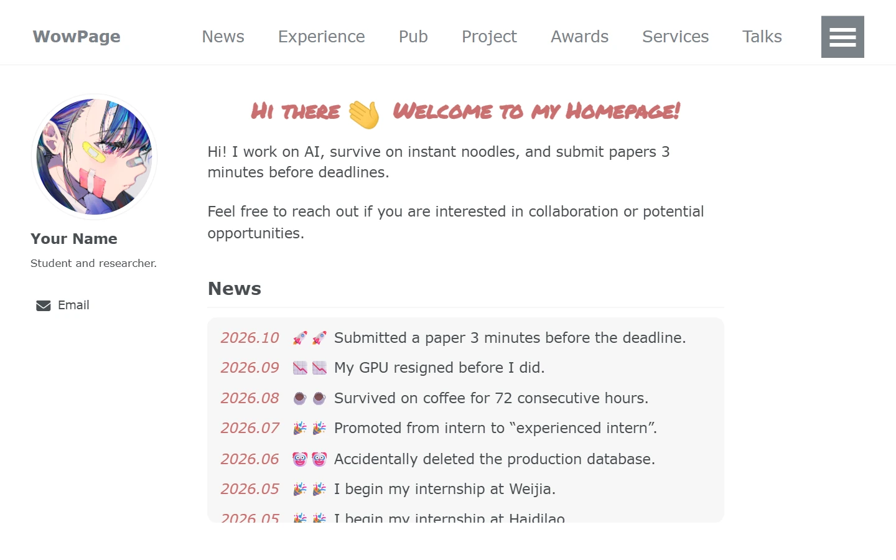
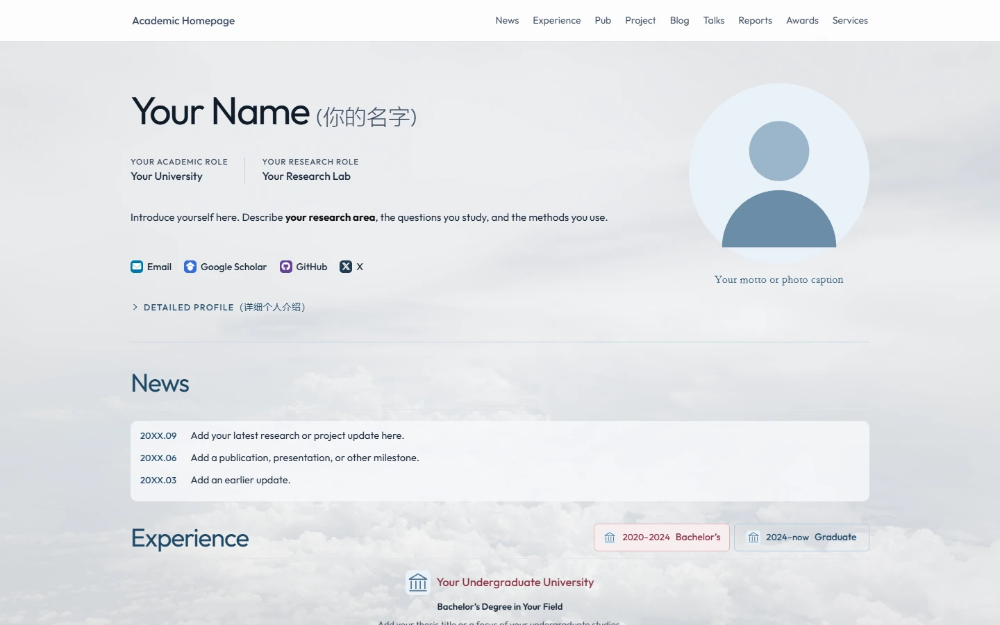
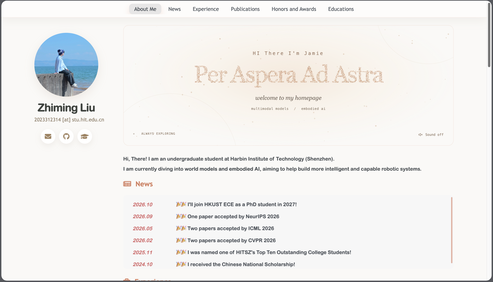
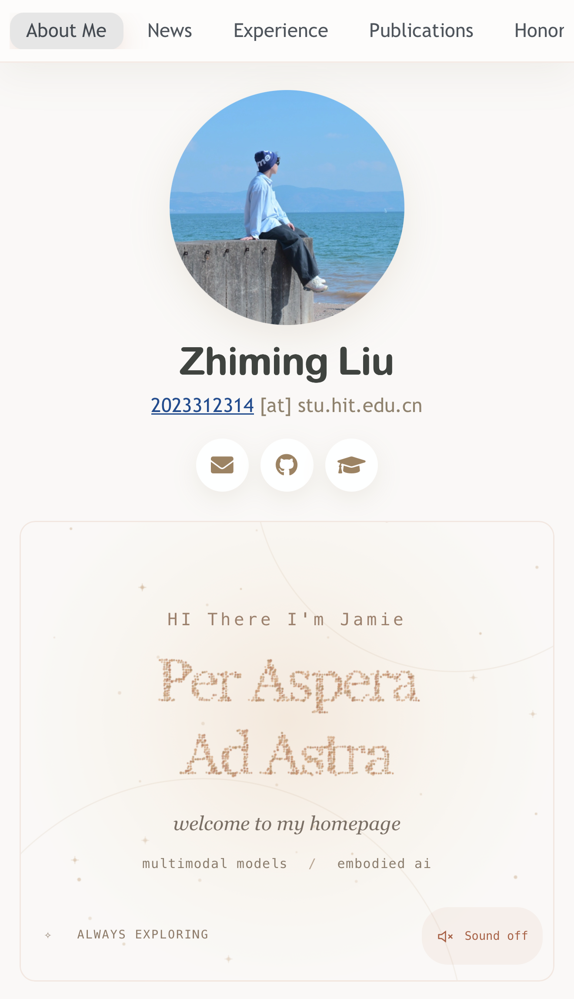

# WowPage

English · [简体中文](README.zh-CN.md)

## Version showcase

| v1 · Classic | v2 · Sidebar | v3 · Current |
| :---: | :---: | :---: |
| [](https://wd7ang.github.io/WowPage/v1/) | [](https://wd7ang.github.io/WowPage/v2/) | [](https://wd7ang.github.io/WowPage/) |
| [Live demo](https://wd7ang.github.io/WowPage/v1/) · [Source](https://github.com/WD7ang/WowPage/tree/v1) | [Live demo](https://wd7ang.github.io/WowPage/v2/) · [Source](https://github.com/WD7ang/WowPage/tree/v2) | [Template demo](https://wd7ang.github.io/WowPage/) · [Source](https://github.com/WD7ang/WowPage/tree/v3) |

WowPage **v3.0.0** is a single-page Jekyll template for an academic homepage. Replace the placeholder name, portrait, bilingual introduction, academic timeline, papers and projects with your own. The three previews above show each version of the template.

## Quick start

Use **Use this template** to create your own repository, or run the template locally with Ruby and Bundler.

```sh
git clone https://github.com/WD7ang/WowPage.git
cd WowPage
bundle install
bundle exec jekyll serve
```

Open the address printed by Jekyll. Restart the server after editing `_config.yml`. To use an earlier design, check out its branch before running `bundle install`.

## Make it yours

| To change | Edit |
| --- | --- |
| Site title, name, portrait, email, social links | `_config.yml` |
| Roles, short introduction, portrait caption, language tabs | `_data/profile.json` |
| Academic stages and placements | `_data/education.json`, `_data/experience.json` |
| Papers, venue index and project cards | `_data/publications.json`, `_data/projects.json` |
| News, talks, reports, awards and services | The corresponding JSON files in `_data/` |
| Homepage Blog cards | `_includes/home/blog.html` |
| Navigation, section order, optional playlist | `_data/navigation.yml`, `_pages/about.md`, `_data/music.json` |

See the [customization guide (中文)](docs/customization.md) for field examples and the [changelog](CHANGELOG.md) for version history.

## Deploy and verify

In your template repository, select **Settings → Pages → Deploy from a branch**, then choose `main` and `/ (root)`. For a user site, name the repository `YOUR-USERNAME.github.io`. Project sites use the repository name as their URL prefix. GitHub Pages can infer `url`, `baseurl` and `repository` when those settings are blank.

To check a project-site build locally, use its actual prefix for both commands. For a root site, omit both `--baseurl` arguments. The checker uses Node.js 20+ and runs without installing npm dependencies.

```sh
bundle exec jekyll build --baseurl /WowPage
node scripts/check-site.mjs --baseurl /WowPage
```

## Credits and license

WowPage grew from [Yue Su / Selen-Suyue’s homepage](https://selen-suyue.github.io/) and was developed by Weidong Tang and Yue Su. It builds on [AcademicPages](https://github.com/academicpages/academicpages.github.io) and [Minimal Mistakes](https://github.com/mmistakes/minimal-mistakes). The template is released under the [MIT License](LICENSE). The bundled Outfit typeface is distributed under the [SIL Open Font License](assets/fonts/Outfit-OFL.txt).

## Community showcase

| Preview (Mac) | Preview (iPhone) | Link |
| --- | --- | --- |
|  |  | **Zhiming Liu**<br>[https://mikuz12.github.io/](https://mikuz12.github.io/) |
