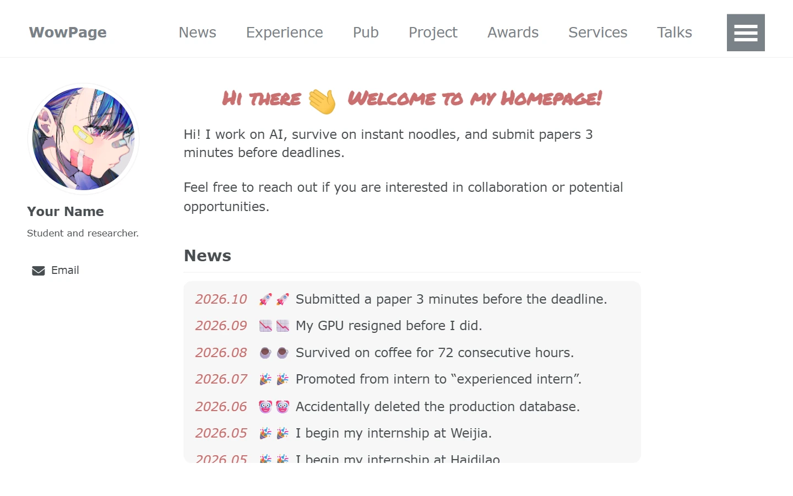

# WowPage

[English](README.md) · 简体中文

## 版本展示

| v1 · 经典版 | v2 · 侧栏版 | v3 · 当前版 |
| :---: | :---: | :---: |
| [](https://wd7ang.github.io/WowPage/v1/) | [](https://wd7ang.github.io/WowPage/v2/) | [](https://wd7ang.github.io/WowPage/) |
| [在线预览](https://wd7ang.github.io/WowPage/v1/) · [源码](https://github.com/WD7ang/WowPage/tree/v1) | [在线预览](https://wd7ang.github.io/WowPage/v2/) · [源码](https://github.com/WD7ang/WowPage/tree/v2) | [模板预览](https://wd7ang.github.io/WowPage/) · [源码](https://github.com/WD7ang/WowPage/tree/v3) |

WowPage **v3.0.0** 是可部署到 GitHub Pages 的 Jekyll 单页学术主页模板。姓名、头像、双语简介、学业经历、论文和项目均使用可替换的占位内容。上方三个预览分别对应三个版本的模板。

## 快速开始

点击 **Use this template** 创建自己的仓库。也可以安装 Ruby 和 Bundler 后，在本地运行模板。

```sh
git clone https://github.com/WD7ang/WowPage.git
cd WowPage
bundle install
bundle exec jekyll serve
```

打开终端显示的预览地址。修改 `_config.yml` 后需要重启服务。使用旧版时，先切换到对应版本分支，再运行 `bundle install`。

## 替换自己的内容

| 要修改的内容 | 文件 |
| --- | --- |
| 站点标题、姓名、头像、邮箱和社交链接 | `_config.yml` |
| 职位、首页简介、照片题注和各语言的详细介绍 | `_data/profile.json` |
| 学业阶段和各阶段的实习、科研经历 | `_data/education.json`、`_data/experience.json` |
| 论文、会议索引和项目卡片 | `_data/publications.json`、`_data/projects.json` |
| 新闻、报告、媒体报道、奖项和服务 | `_data/` 下的对应 JSON 文件 |
| 首页 Blog 占位卡片 | `_includes/home/blog.html` |
| 导航、栏目顺序、可选歌单 | `_data/navigation.yml`、`_pages/about.md`、`_data/music.json` |

具体字段与填写示例见[自定义指南](docs/customization.md)，版本记录见[更新日志](CHANGELOG.md)。

## 部署与验证

在自己的模板仓库打开 **Settings → Pages → Deploy from a branch**，选择 `main` 和 `/ (root)`。将仓库命名为 `你的用户名.github.io` 即可部署到个人站点根路径；其他仓库名会成为项目站点的路径前缀。`_config.yml` 中的 `url`、`baseurl`、`repository` 留空时可由 GitHub Pages 自动识别。

本地验证项目站点时，两条命令使用相同的仓库路径。验证根路径时，去掉两处 `--baseurl /WowPage`。检查脚本需要 Node.js 20 或更新版本，可直接运行。

```sh
bundle exec jekyll build --baseurl /WowPage
node scripts/check-site.mjs --baseurl /WowPage
```

## 版权与致谢

WowPage 起源于 [Yue Su / Selen-Suyue 的主页](https://selen-suyue.github.io/)，由汤维栋与 Yue Su 开发，基于 [AcademicPages](https://github.com/academicpages/academicpages.github.io) 和 [Minimal Mistakes](https://github.com/mmistakes/minimal-mistakes)。模板采用 [MIT 许可证](LICENSE)。随模板提供的 Outfit 字体使用 [SIL 开放字体许可证](assets/fonts/Outfit-OFL.txt)。
